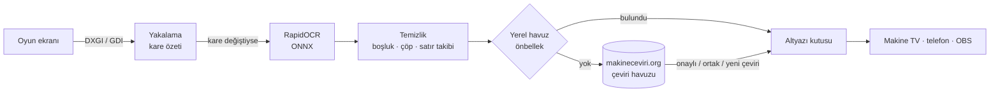

<p align="center">
  
</p>

<h1 align="center">Makine Live</h1>

<p align="center">
  Oyun ekranındaki İngilizce diyalogları okuyup <b>anında Türkçe altyazı</b> olarak gösteren canlı çeviri motoru.<br>
  <a href="https://makineceviri.org">Makine Çeviri</a> ekosisteminin parçası; <a href="https://github.com/MakineCeviri/Makine-Launcher">Makine Launcher</a> eklentisi.
</p>

<p align="center">
  
  
  
  <a href="LICENSE"></a>
</p>

<p align="center">
  <a href="https://makineceviri.org/live/"><b>İndir</b></a> ·
  <a href="docs/GTA6_MAKINE_LIVE_REHBERI.md">Kullanım rehberi</a> ·
  <a href="docs/KONSOL_TV.md">Konsol / TV modu</a> ·
  <a href="docs/MIMARI.md">Teknik mimari</a> ·
  <a href="SECURITY.md">Güvenlik</a>
</p>

---

## Ne yapar?

Makine Live, oyun oynarken ekranın altyazı bölgesini sürekli okur (OCR), yeni bir satır belirdiğinde onu Türkçeye çevirir
ve oyunun üstünde, okunması kolay bir altyazı kutusu olarak gösterir. Oyunun dosyalarına dokunmaz; yama gerektirmez.

Canlı çeviride iki sorun vardır: makine çevirisi her satırda 400–900 ms sürer ve aynı cümleler binlerce oyuncu tarafından
tekrar tekrar çevrilir. Makine Live bunu bir **ortak çeviri havuzu** ile çözer:

1. Okunan satır önce bilgisayardaki önbelleğe ve oyunun **onaylı çevirilerine** bakılarak aranır; bulunursa ağa hiç çıkılmaz.
2. Yoksa satır [makineceviri.org](https://makineceviri.org) havuzuna sorulur. Havuzda da yoksa sunucu satırı **bir kez**
   çevirir; aynı satırı gören sonraki oyuncular aynı çeviriyi alır.
3. Her oyuncu bir oy sayılır. Farklı hesaplardan uyuşan çeviriler gelince satır kendiliğinden onaylanır; uyuşmayanları
   Makine Çeviri çevirmenleri inceler, düzeltir ve onaylar. Oyun oynandıkça havuz büyür ve kalitesi artar.

## Özellikler

- **Hızlı ekran okuma:** DXGI Desktop Duplication (değişmeyen sahnede ~1 ms), gerektiğinde GDI; tam ekran oyunlarda çalışır.
- **Yerel OCR:** RapidOCR (PaddleOCR modelleri + ONNX Runtime). Görüntü bilgisayardan çıkmaz; sunucuya yalnızca metin gider.
- **Oyun yazılarına özel temizlik:** yapışık kelimeleri ayırma ("Iwas goingto" → "I was going to"), yabancı alfabe gürültüsü ve
  çöp satır filtresi, daktilo efektinde satır takibi, titreyen OCR için kararlılık beklemesi.
- **Ortak çeviri havuzu:** onaylı çeviriler bilgisayara iner ve çevrimdışı da çalışır; aynı satır bir daha çevrilmez.
- **Okunabilir altyazı:** piksel bazında saydam kutu, satırın ekranda kaldığı süre ve okuma hızına göre zamanlama,
  kutu yayında ve ekran paylaşımında gizli (isteğe bağlı görünür).
- **Yalnızca oyunlar:** Steam, Epic, GOG, Ubisoft Connect, EA, Xbox / Game Pass ve Windows oyun listesinden kurulu oyunları
  tanır; tarayıcı, Discord ya da başka bir pencere asla okunmaz.
- **Konsol / TV modu:** PS5 ve Xbox oyunları için. Konsolun görüntüsü PC'de (PS Remote Play, Xbox uygulaması, yakalama
  kartı) okunur; altyazı TV'deki **Makine TV** uygulamasında (Android TV / Google TV, LG webOS), PC ekranında,
  telefonda ya da OBS tarayıcı kaynağında gösterilir.
- **Makine Çeviri hesabıyla giriş:** uygulama bir kod gösterir, tarayıcıda onaylarsınız. Kullanıcının API anahtarı gerekmez.

## Nasıl çalışır?



Ayrıntılar (C ABI, yakalama, pipeline, sunucuyla sözleşme, konsensüs kuralları, normalizasyon, uygulama ve TV protokolü):
**[docs/MIMARI.md](docs/MIMARI.md)**.

## Bileşenler

| Bileşen | Klasör | Durum |
|---|---|---|
| **`makine-live.dll`** — C++23 çekirdeği: yakalama, OCR, temizlik, önbellek, çeviri. Makine Launcher'ın yüklediği nihai ürün (`.makine` paketi) | `src/`, `include/` | beta |
| **Makine Live uygulaması** — tek dosyalık `MakineLive.exe`: kontrol paneli, oyun algılama, yerel havuz, altyazı kutusu, konsol modu. Özellikler önce burada denenir, sonra DLL'e taşınır | `makine_live/` | 0.3.2 beta |
| **Makine TV (Android TV / Google TV)** — HDMI görüntüsünün üstüne altyazı çizen katman uygulaması | `tv/` | beta |
| **Makine TV (LG webOS)** — konsol görüntüsünü kendi içinde açıp altyazıyı üstüne yazan uygulama + servis | `tv-webos/` | beta |
| **Sunucu** — çeviri havuzu, hesaplar, çevirmen portalı (`makineceviri.org/api/live/`, Cloudflare Workers) | ayrı depo | canlı |

## Kullanım

1. [makineceviri.org/live](https://makineceviri.org/live/) adresinden `MakineLive.exe`'yi indirip açın (kurulum gerekmez).
2. **Makine Çeviri hesabıyla giriş yap**'a basın, tarayıcıda açılan sayfada kodu onaylayın.
3. Oyunu açın; Makine Live oyunu kendisi bulur. Altyazı bölgesini **F10** ile seçin, **F9** ile başlatın.
   **F8** altyazı kutusunu kilitler / taşınabilir yapar.

Konsolda (PS5 / Xbox) oynuyorsanız: [docs/KONSOL_TV.md](docs/KONSOL_TV.md). Kurulumdan TV modellerine, telefon ve OBS'ye
kadar ayrıntılı rehber: [docs/GTA6_MAKINE_LIVE_REHBERI.md](docs/GTA6_MAKINE_LIVE_REHBERI.md).

**Makine Launcher eklentisi olarak:** `makine-live.makine` paketini Launcher → Ayarlar → Eklentiler'den yükleyin.

## Geliştirme

### Gereksinimler

- Windows 10/11 (x64)
- GCC 15 (MinGW-w64) ya da C++23 destekli başka bir derleyici, CMake ≥ 3.25, Ninja
- Python 3.13+ (masaüstü uygulaması, testler ve paketleme için): `py -m pip install -r requirements.txt`
- İsteğe bağlı: Android SDK + JDK 17 (Makine TV), Node.js (LG servis testi)

### OCR çalışma dosyaları

Boyutları nedeniyle depoda değiller. `python tools/fetch_ocr.py` hepsini adresi ve SHA-256'sı sabitlenmiş olarak
`.cache/ocr/` altına indirir (ikinci çalıştırmada yalnızca doğrular): nuget.org'daki resmî Microsoft.ML.OnnxRuntime
1.24.3 paketinden `onnxruntime.dll` ve C API başlığı, PP-OCRv3 modelleri; onnxruntime'ın istediği VC++ çalışma
dosyaları yerel Visual Studio redist klasöründen kopyalanır. Her DLL'in Microsoft Authenticode imzası denetlenir.
CMake bunları `build/package/` altına kopyalar.

```
.cache/ocr/
├── bin/onnxruntime.dll, msvcp140.dll, msvcp140_1.dll, vcruntime140.dll, vcruntime140_1.dll
├── include/onnxruntime_c_api.h     (yalnız derleme)
├── models/
│   ├── ch_PP-OCRv3_det_infer.onnx
│   ├── ch_PP-OCRv3_rec_infer.onnx
│   └── ppocr_keys_v1.txt
└── licenses/
```

### Derleme ve paketleme

Tek adımda sürüm: `build.cmd`'ye çift tıklayın ya da komut satırından çalıştırın. Makine TV APK'sını derler
(`tv\gradlew.bat assembleRelease`), OCR dosyaları yoksa indirir, DLL'i derler, testleri çalıştırır, eklentiyi gerçek
`makine-plugin-host.exe`'de açar (bulursa: `MAKINE_PLUGIN_HOST`, `../Makine-Launcher/build/dev/`) ve
`build/org.makineceviri.live-<sürüm>.mkplugin`'i paketler; sonunda boyutu ve SHA-256'yı yazar.

```powershell
build.cmd                        # yeni sürüm numarasını sorar (boş = aynı sürüm)
build.cmd 0.4.1                  # sürümü her yerde 0.4.1 yapar, sonra derler
build.cmd --hizli                # testleri atlar
```

Makine TV APK'sı için Android SDK (`tv/local.properties` içinde `sdk.dir=…` ya da `ANDROID_HOME`) ve JDK 17 gerekir.
İmza: `MAKINE_TV_KEYSTORE` (+ `MAKINE_TV_KEYSTORE_PASS`) tanımlıysa o anahtar, değilse `~/.android/debug.keystore`.
TV'lerde kurulu uygulama ancak aynı anahtarla imzalı bir APK ile güncellenir: anahtarı yedekleyin, değiştirmeyin.

Sunucuya bağlanmadan denemek için `test.cmd`: bilgisayarda küçük bir sahte sunucu açar ve uygulamayı ona bağlar
(giriş kendiliğinden onaylanır, çeviriler örnek repliklerden ya da indirilmiş onaylı havuzdan gelir). Gerçek oturuma ve
ayarlara dokunmaz; `test.cmd --exe` derlenmiş exe'yi, `test.cmd --temiz` ilk açılışı (bağış penceresi) dener.

Adım adım:

```powershell
python tools/fetch_ocr.py        # OCR çalışma dosyaları (bir kez)
cmake -B build -G Ninja -DCMAKE_BUILD_TYPE=Release
cmake --build build              # → build/package/ (Makine'nin paketlediği eklenti)
cmake --build build --target pack   # → build/org.makineceviri.live-<sürüm>.mkplugin
py -m makine_live                # test koşucusunu derlemeden çalıştırma (geliştirme)
```

`build/package/`: `manifest.json`, `bin/makine-live.dll` (girdi), `bin/onnxruntime.dll` + VC++ çalışma dosyaları, `models/`,
`resources/en_words.txt`, `licenses/`. Makine bu klasörü `plugins/org.makineceviri.live/` olarak paketine koyar.

### Testler

```powershell
py tests/test_plugin.py          # DLL ABI, ayarlar ve DPAPI, gerçek OCR
py tests/test_normalization.py   # ortak normalizasyon vektörleri
ctest --test-dir build           # C++: spec vektörleri (normalizasyon, çöp), OCR süzgeci, altyazı zamanlaması,
                                 # konsol geometrisi, yerel havuz, boşluk düzeltici (tests/cpp/test_logic.cpp)
```

Bütün testlerin listesi ve gereksinimleri: [tests/README.md](tests/README.md).

### Geliştirme sunucusu

Uygulama varsayılan olarak `https://makineceviri.org` ile konuşur. Yerel bir sunucuya bağlamak için
`MAKINE_LIVE_SERVER` ortam değişkenini ayarlayın.

### Makine olmadan çalıştırma

Eklentiyi Makine'nin gerçek eklenti süreciyle (`makine-plugin-host.exe`) ama Makine'yi açmadan çalıştırmak için:

```powershell
python tools/plugin_dev.py build/package --host <Makine klasörü>/makine-plugin-host.exe --invoke state --invoke readOnce
```

`--region X,Y,W,H` bölge seçimini yanıtlar; `--invoke login.start` giriş kodunu ister (kod `ui.state` olayında görünür).

## Makine Launcher eklentisi (ABI 2)

Makine Live, Makine'nin içinde gelen (bundled) bir eklentidir: `org.makineceviri.live`, eklenti ABI 2
(`include/makine/plugin/abi.h`, `sdk.hpp`; Makine-Launcher `core/include/makine/plugin/` ile birebir aynı).
Makine onu kendi `makine-plugin-host.exe` sürecinde çalıştırır; ekranını Makine çizer, eklenti yalnızca durum
yayınlar. Python ya da `MakineLive.exe` gerekmez, eklenti hiçbir şey indirip çalıştırmaz.

- `initialize` yalnız ayarları okur ve iş parçacıklarını başlatır (< 1 sn). OCR çalışma dosyaları ve modeller ilk
  `start` / `readOnce`'ta yüklenir. Her şey `dataDir`'e yazılır (`settings.cfg`, `device_id`, `pool/`, `ocr/`);
  `pluginDir` salt okunurdur (MSIX).
- Oturum jetonu `settings.cfg`'de Windows DPAPI ile şifreli durur. Cihaz kimliği eklentiye özgü, `dataDir\device_id`.
- İstekler `pool_client.py` ile aynı başlıkları taşır (`X-Makine-Device`, `X-Makine-Version`, `User-Agent:
  MakineLive/<sürüm>`) ve `X-Makine-Client: launcher/<Makine sürümü>`. Sunucunun güncelleme yanıtındaki indirme
  kullanılmaz (eklentiyi Makine günceller); bakım ve zorunlu güncelleme `ui.state` → `server` ile gösterilir.
- Çöp / HUD süzgeci, normalizasyon ve havuz anahtarı, satır takibi ve altyazı zamanlaması Python koşucusunun birebir
  C++ karşılığıdır (`src/garbage.cpp`, `src/subtitle_timing.cpp`, `src/unitext.cpp`); `ctest` aynı vektörlerle sınar.
- OCR (F1, OCR_KARAR): onnxruntime C API'siyle PP-OCRv3 algılama + Çince tanıma, yakalanan kare bellekten okunur (kare başına dosya yazılmaz), satırlar soldan sağa birleştirilir. `bin/onnxruntime.dll` Microsoft imzalı (1.24.3), eklenti klasöründen tam yolla yüklenir; yanında VC++ çalışma dosyaları. RapidOcrOnnx, açı sınıflandırıcısı ve ABI 1 dışa aktarımları (Python koşucusunun `build/release`'i) kaldırıldı. Kapı: `live_ocr_gate` ocrbench karelerini kıyas aracının ORT yoluyla birebir aynı okumalı (`ctest -R ocr_gate`).

### Launcher screen API

Makine'nin Makine Live ekranı `PluginManager.invoke(id, method, params)` ile çağırır. Her yanıt JSON'dur; hata
`{"message"}` ile döner. Uzun işler (giriş, bölge seçimi) hemen döner, sonucu `ui.state` getirir.

| Yöntem | Parametre → yanıt |
|---|---|
| `state` | → tam durum (aşağıda) |
| `login.start` | → `{message}`; kod ve bağlantı `ui.state.login`'de, tarayıcı `ui.openUrl` ile açılır |
| `login.team` | `{username, password}`: ekip hesabı (yönetici, çevirmen, test) şifreyle (`auth?action=app_login`); şifre saklanmaz, günlüğe yazılmaz; jeton cihaz girişindeki gibi DPAPI ile kalır. Sonuç `ui.state.login` (`role`) |
| `login.cancel` | giriş beklemesini bırakır |
| `logout` | oturumu kapatır (sunucuda da) |
| `mode.set` | `{mode: "pc" \| "console"}` |
| `console.sources` | `{all?: bool}` → `{sources: [{id, key, label, console, exe, title, pid}]}`; `all` başka büyük pencereleri de listeler |
| `console.select` | `{sourceId}` (`console.sources`'tan); listede olmayan bir pencere seçilirse exe'si kaynak olarak hatırlanır |
| `region.pick` | PC'de ekrandan, konsolda kaynağın 16:9 video alanı içinden (`overlay.pickRegion {within}`) bölge seçtirir |
| `start` / `stop` | okumayı başlatır / durdurur (giriş ve PC'de bölge gerekir) |
| `box.move` | `{on?}` (yoksa tersine çevirir): altyazı kutusunu sürüklenebilir yapar / kilitler. Makine'nin isteğe bağlı `overlay.setMovable {on}` yöntemini çağırır; `on:false` yanıtı `{x, y}` (kutu merkezi, ekrana oran) getirirse `style.boxX/boxY` olarak saklanır. Makine bu yöntemi bilmiyorsa `E_UNSUPPORTED` ve `boxMove.supported: false`. Sürüklemeden sonra Makine `overlay.moved {x, y, width, height}` (fiziksel px) olayını da gönderir; aynı yere çevrilip saklanır (manifestte bildirilmez: Makine bu olayı yalnız taşıyan eklentiye yollar) |
| `readOnce` | → `{text, filtered, region, window}`: bölgeyi bir kez okur, çevirmez |
| `autoStart.set` / `usageReport.set` | `{enabled}` → Makine'nin ayar deposuna `settings.set` ile yazılır (manifest ayarları; Makine `autoStart`'ı eklenti kapalıyken de okur) |
| `style.set` | `{preset, font, sizePx, …}` (Makine'nin `overlay.show.style` anahtarları; `null` siler) → `{style}`. `minShowMs` (600–3000, varsayılan 1200; 0.3.2'deki "En kısa gösterim"): bir satırın en az ekranda kalma süresi, her çıktıda (kutu, TV, telefon / OBS) |
| `output.set` | `{output: "pc" \| "tv" \| "phone"}`: konsol modunda altyazı nerede (Remote Play penceresinin üstü / Makine TV / telefon-tablet sayfası) |
| `obs.set` | `{enabled}` → `{obsUrl}`: OBS tarayıcı kaynağı (`http://127.0.0.1:47712/obs`, yalnız bu bilgisayar) |
| `tv.discover` | ev ağında Makine TV arar (~1,6 sn); sonuç `ui.state.tv.found` |
| `tv.pair` | `{id, code}` (`tv.found`'dan) ya da `{host, port?, code}` (adresle bağlan); konsol modunda çıktıyı `tv` yapar |
| `tv.unpair` | eşleşmeyi siler |
| `tv.install.scan` | `{platform: "android" \| "lg"}`: ev ağında ADB (5555) / LG geliştirici modu (9922) açık cihazlar → `tvInstall.hosts` |
| `tv.install` | `{platform: "android", host, port?}`: Android TV / Google TV / Fire TV'ye ADB ile kurar; ilerleme `tvInstall.step`, sonuç `tvInstall.state` (`running` · `done` · `error`) ve `message`. `{platform: "lg", host, passphrase}`: LG webOS'a geliştirici modu üzerinden kurar (aynı ilerleme alanları) |
| `tv.install.saveFile` | `{platform: "android" \| "lg"}` → `{path}`: `makine-tv.apk` / `.ipk` İndirilenler klasörüne (USB bellek ya da elle kurulum) |
| `consoleConsent.set` | `{granted}` ya da `{enabled}`: konsol modunda her satırın GTA VI havuzuna gittiğine oyuncunun onayı; onaysız `start` konsolda `E_DENIED` "consent_required: …" döner |
| `announcement.read` | `{id}` (sayı ya da rakamlardan oluşan metin): duyuruyu kapatır (sunucuya `ann_read`) |
| `status.refresh` | bakım / sürüm / duyuruları hemen yeniden sorar (bakım sürerken kendiliğinden 30 sn'de bir, yoksa 300 sn). Bakım okumayı durdurur; bakım bitince okuma kendiliğinden yeniden başlar |
| `sample` | örnek bir replik (`resources/sample_quotes.json`) açık her çıktıya (kutu, TV, telefon / OBS) 4 sn gider |
| `region.keepGrown` | kesik satır yüzünden bu oturumda büyüyen bölgeyi (`regionGrow`) kalıcı kaydeder (bulunan bantta da) |
| `autoRegion.accept` | önerilen altyazı bandını (`autoRegion.state: found`) bu oyun için kilitler ve saklar |
| `autoRegion.reset` | bandı ve oyuncunun kendi bölgesini unutur, altyazıyı yeniden arar |
| `support.dismiss` | "kayıt gönderildi" kartını kapatır |
| `pools.refresh` | oyun havuzlarının sunucudaki onaylı satır sayısını sorar (`pool?action=sync&head=1`, oyun başına bir istek, okuma sürerken tek tek, yoksa ikişer); sonuçlar geldikçe `ui.state.pools`. Giriş gerekir; bakımda `E_FAILED` |
| `pools.download` | `{slug}` (`pools.items`'tan): o oyunun onaylı satırlarını bu bilgisayara indirir (oyun yerel havuzda onaylanır, sonra güncellemeleri kendiliğinden gelir). Listede olmayan slug `E_NOT_FOUND` |
| `pools.downloadAll` | `missing` (sunucu sayısı bilinen) ve `outdated` havuzların hepsini sırayla indirir; yoksa "İndirilecek havuz yok; hepsi güncel." |
| `donate` / `donate.dismiss` | bağış sayfasını (`makineceviri.org/destek`) `ui.openUrl` ile açar / ilk açılış kartını kapatır |

`ui.state` (her değişiklikte `emitEvent`):

```json
{
  "login": {"state": "signedOut|checking|starting|waiting|signedIn|offline", "code", "url", "user", "role", "message"},
  "history": [{"source", "text", "kind": "verified|pending|api", "origin", "at"}],   // bu oturum, en yeni önde, en çok 50
  "hotkeys": {"armed", "keys": {"start|region|move": {"key": "F9|…|off", "active", "error"}}},
  "boxMove": {"on", "supported"},
  "regionGrow": {"left", "right", "top", "bottom"},   // bu oturumda kesik satır yüzünden büyüme (bölge boyunun payı, en çok 0.3)
  "mode": "pc|console",
  "sources": [ ... ], "selectedSource": {"key", "pid"} | null,
  "region": {"pc": {"x", "y", "width", "height"} | null, "console": {"x", "y", "width", "height"} (video alanına oran)},
  "picking": false, "running": false, "status": "…",
  "lastLine": {"source", "text", "kind", "origin"} | null,
  "counters": {"lines", "poolHits", "hitPct" | null, "avgMs" | null (son 30 çeviri isteği), "startedAt" | null (unix sn, okuma sürerken)},
  "server": {"maintenance", "message"}, "notice": "…",
  "style": { ... }, "game": {"name", "slug"}
  "autoStart": false, "usageReport": true, "consoleConsent": false, "everStarted": false,
  "reason": {"code", "text", "action"} | null,   // en engelleyici tek neden (aşağıda)
  "autoRegion": {"state": "off|searching|found|locked|manual", "rect": {"x", "y", "width", "height"} | null, "confidence",
                 "screenRect": {"x", "y", "width", "height"} | null},   // rect: oyun penceresine / konsol video alanına oran;
                 // screenRect: aynı bölge fiziksel ekran pikselinde (bölge seçici için; PC'de elle bölge = region.pc),
                 // oyunun penceresi / video alanı bilinmezken null. Okuma yokken de: elle bölge manual, saklı bant locked
  "output": "pc|tv|phone", "obs": false,
  "web": {"running", "lan", "port", "clients", "obsUrl", "phoneUrl", "error", "firewallNote", "firewallHeadsUp"},
  "tv": {"state": "idle|connecting|connected|bad_code|offline", "detail", "paired": {...} | null, "found": [{"id", "name", "host", "port"}], "searching", "hopP50", "hopP95"},
  "tvInstall": {"platform", "state", "step", "message", "hosts": [...], "scanning", "apkAvailable", "ipkAvailable",
                "guide": {"android": [...], "firetv": [...], "lg": [...]}},
  "discord": {"connected"},
  "announcements": [{"id", "kind", "kindLabel", "title", "body", "author", "createdAt"}],
  "support": {"time", "sizeKb"} | null,
  "pools": {"refreshing": false, "updatedAt": 1795526851 | null,   // son sunucu yoklaması (unix sn), ayarlarda kalır
            "items": [{"slug", "name", "local": 120,              // bu bilgisayardaki onaylı satır
                       "remote": 160 | null,                      // sunucudaki (null: henüz sorulmadı)
                       "state": "current|outdated|missing|downloading|error|empty",
                       "error": "…",                              // yalnız state error iken
                       "playing": true}]},                        // şu anki oyun (konsol modunda GTA VI)
  "donate": {"url", "seen"}
}
```

**Altyazıyı kendi bulur** (`subtitle_finder.*`): bölge seçilmemişse (PC) ya da konsolda oyuncu kendi bölgesini çizmemişse okuma başlar başlamaz 2 sn'de bir oyunun penceresi (konsolda video alanı; dışı asla okunmaz) 640 px'e küçültülüp yalnız dedektörden geçer; ortalı, alt üçte birde ya da üstte, açık dolgu + koyu konturlu, kelime olan ve diyalogla gelip giden, metni değişen, tabanı sabit satırlar kanıt biriktirir (HUD yazısı hep durur ya da hiç değişmez). ~8 sn'de `found` (bant okunur), ~18 sn yüksek güvenle ya da `autoRegion.accept` ile `locked`: oyun başına saklanır, dedektör durur. Ararken pencerenin alt ortası okunur. Bulucunun okuduğu metin havuza gitmez; bant değişince yarım satır gönderilmez. Kenara dayanan uzun satır bölgeyi o yöne geçici büyütür (adım %15, yan başına en çok %30, oyun penceresi içinde), 4 sn o kenarda yazı yoksa geri küçülür. Kapı: `tools/make_scene_frames.py` + `live_finder_gate`.

**Uzun çeviri** (`fit.*`): `overlay.show` isteğe bağlı `fit: {maxLines, minFontScale: 0.8, maxWidthFrac: 0.9, chunk, chunks}` taşır. Çizen taraf satırı `maxLines`'a sarar, yazıyı en çok `minFontScale`'e küçültür, bandı karenin `maxWidthFrac`'ına genişletir; bu üçüyle de sığmayacak satırı eklenti cümle / yan cümle / kelime sınırından parçalara böler ve sırayla gönderir (`text` / `lines` o parçayı taşır, `chunk` 0'dan sayar; her parça okuma süresince, ~17 harf/sn, en az `minShowMs`). TV ve telefon / OBS satırları da `fit: {chunk, chunks}` alır (yalnız birden çok parçada). Eski Makine'ler parçayı düz satır gibi gösterir.

Çeviri `overlay.show` ile gider: `text` (eski Makine'ler için), `lines: [{text, sourceText?}]` (konuşmacı başına bir satır), bölge (`x, y, width,
height`; konsolda video alanındaki bölgenin ekran karşılığı) ve kayıtlı `style`; konsolda "Bu ekranda" çıktısında `frame: {x, y, width, height}` (fiziksel px), yayın penceresindeki
16:9 video alanıdır (Alt / Üst onun içinde hesaplanır). PC oyununda oyun Makine'nin
`game.started` / `game.stopped` olaylarından ve `games.running`'den gelir; konsol modu her zaman GTA VI havuzudur.
PC modunda okuma yalnızca oyun öndeyken yapılır (test koşucusunun hedef kilidi): Makine `game.started` /
`games.running` içinde isteğe bağlı `pid` gönderirse öndeki pencerenin süreci o olmalı; göndermezse öndeki pencere
Makine olmamalı ve bölgenin ortasını kapsamalı. Ekrandan okunan ve gösterdiğimiz çeviriye benzeyen OCR kutuları
cümle birleştirilmeden önce atılır; yine de Makine'nin kaplama penceresinin `SetWindowDisplayAffinity(
WDA_EXCLUDEFROMCAPTURE)` ile yakalamadan gizlenmesi gerekir. Yerel havuz, oyun Makine'nin kütüphanesinden
geldiği için sormadan indirilir. Katalog dışı oyunlar `{gameId: "exe:<exe>", name, pid, exe, catalog: false}` ile gelir: havuz adı `name`dan (yol ya da exe adıysa yalnız dosya adının gövdesi) türer, harf yoksa oyun okunmaz (`game_unidentified`); Remote Play gibi konsol yayın uygulamaları bu yoldan da GTA VI sayılır, ayrı bir PC oyunu olmaz.

**Havuz kalitesi** (sunucunun `src/live/text.ts` kuralları, `garbage.cpp`'de `<regex>` olmadan; sunucunun vektörleri
`spec/speaker_vectors.json`, `line_issue_vectors.json`, `clipped_edge_vectors.json` ctest'te): konuşmacı etiketi ve dil
notu satırdan ayrılır ("Jason: What?" → anahtar ve `/translate` yalnız "What?"); ekranda etiket çevirinin önünde,
çevrilmeden durur ("Jason: Ne?", "Mia: (İspanyolca) …"). Tek blokta okunan iki konuşmacı her `[.!?…] Ad:` sınırında
ayrı satır olur. OCR her satırın kutusunu verir: kutu bölgenin kenarına değiyor ve kenardaki kelime gerçek değilse
(ya da sarılmış altyazının öbür satırı üstte / altta kalmışsa) satır gönderilmez, bölge o yöne %10 büyür (bu oturum,
yan başına en çok 3 kez) ve sonraki kare yeniden okunur; oyuncu `region.keepGrown` ile kalıcı yapar.

**Kısayollar** (0.3.2 exe'deki gibi: F9 başlat/durdur, F10 bölge seç, F8 kutuyu taşı/kilitle): manifest ayarları
`hotkeyStart` / `hotkeyRegion` / `hotkeyMove` (F1–F12 ya da `off`). Eklentinin kendi iş parçacığında, yalnız mesaj
alan bir pencereye `RegisterHotKey` (klavye kancası yok). Windows tuşu kaydedenden başka programlara vermez; bu
yüzden tuşlar yalnız giriş yapılmışken ve bir oyun açıkken (ya da konsol modunda) alınır (`hotkeys.armed`). Başka
programın tuttuğu tuş `keys.<eylem>.error`'da yazar; sonraki eşitlemede yeniden denenir. Kısayolun hatası oyuncu
oyundayken `ui.notify` ile söylenir.

**Neden kodları** (`ui.state.reason`, OCR_KARAR §6; serbest metin `status` yalnız ayrıntıdır), öncelik sırasıyla.
`action` ekranın olduğu gibi çağırdığı bir invoke yöntemidir ya da ekranın kendi işi (`launcher.update`, `tv.pairForm`);
yoksa düğme yoktur, metin yeter: `maintenance` · `update_required` (`launcher.update`) · `signed_out` (`login.start`) ·
`offline` (`status.refresh`) · `consent_required` (ekran onayı kendisi sorar) · `game_unidentified` ·
`source_missing` / `source_minimized` (`console.sources`) · `source_small` · `black_frame` · `capture_failed`
(`status.refresh`) · `region_missing` (`region.pick`) · `game_missing` · `game_not_front` · `tv_offline` (`tv.discover`) ·
`tv_bad_code` (`tv.pairForm`) · `quota` · `no_key` · `upstream` · `stopped` (`start`).
`stream_stalled`, `stream_poor`, `hdr_washed` OCR hattının güven / kontrast ölçüleriyle gelecek. Çıktı TV iken kaynak
kaybı, siyah görüntü, kota, bakım ve okumanın durması TV'ye `{"t":"note","code","text"}` olarak da gider (boş `text`
notu kaldırır). TV stili isteğe bağlı `relSize` (ekran yüksekliğine oran, 0.046), `safeArea` (0.05), `maxLines` (2),
`text`, `band` alanlarını da taşır; varsayılan koyu şerit, beyaz yazı, opaklık 86. **TV uygulaması:** `note` Android
(`LinkServer.kt`) ve webOS servisinde satır olarak gösterilir; yeni stil alanlarını TV uygulamaları henüz uygulamıyor.

**Konsol okuma hızı (F2).** K3: konsol modunda OCR yalnız altyazı maskesi (koyu konturlu açık dolgu, eşikler karenin
kendi aralığına göre, 8×8 piksel hücre) son OCR'dakinden farklıysa ve en geç 2,5 sn'de bir çalışır; kapı D-C'de G-MISS = 0
(`tools/make_dc_frames.py`, `ctest -R mask_gate`). K12: yerel havuzda tam anahtarı olan satır ilk okumada gösterilir (iki
okuma kuralı aynen sürer). K13: yeni satır belirince 15 sn'dir boşta duran bağlantı `ping` ile açılır. TV, çizdiği satıra
`{"t":"drawn","id"}` yanıtını Makine TV (Android ve LG) satırı ekrana çizince verir; `tv.hopP50/hopP95` gidiş-dönüşün yarısıdır.

**Çıktılar.** Çeviri, PC modunda ve konsol modunda `output: "pc"` iken Makine'nin kaplamasıyla gösterilir; `tv` iken
Makine TV'ye (UDP 47710 keşif, TCP satır-JSON, TV'deki 4 haneli kod; `src/tv_link.cpp`), `phone` iken telefon / tablet
sayfasına (`http://<PC>:47712`, SSE) gider. OBS kaynağı (`/obs`) her modda açılabilir. Sayfalar Python koşucusunun
sayfalarıyla aynıdır (`tools/gen_web_pages.py` → `src/web_pages.inc`), dışarıdan bir şey yüklemez (CSP). Sunucu
telefon açık değilken yalnız 127.0.0.1'i dinler; telefon açılınca ev ağını dinler ve Windows bir kez güvenlik duvarı
izni sorar (`web.firewallNote`). Eklenti güvenlik duvarına kural eklemez.

**Discord** (`src/discord.cpp`): okuma açıkken profilde "… · Türkçe oynuyor", oturum süresi ve çevrilen diyalog;
GTA VI'da Makine × GTA VI görseli. Discord'un yerel IPC kanalı kullanılır, ağa çıkılmaz. Makine'de her zaman açık.

**TV'ye kur.** Android TV, Google TV ve Fire TV: eklenti ADB protokolünü kendisi konuşur (`src/adb.cpp`; adb.exe yok):
RSA-2048 anahtarı Windows CNG ile üretilir, DPAPI ile `dataDir\adbkey.bin`'de durur; TV bir kez "bu bilgisayara izin
verilsin mi" diye sorar. APK `sync:` ile yüklenir, `pm install` ile kurulur, altyazı katmanı izni verilir, uygulama
açılır. LG webOS: geliştirici modundaki TV'nin anahtarı `http://TV:9991/webos_rsa`'dan alınır, Passphrase ile çözülür
(Windows CNG), libssh2 (WinCNG) ile `prisoner@TV:9922`'ye bağlanılır, `.ipk` yüklenip `luna-send` ile kurulur ve açılır
(`src/webos_install.cpp`); elle kurulum için `tv.install.saveFile` duruyor.
Paketler: `resources/makine-tv.apk` (`tv\gradlew.bat assembleRelease`; imzalı sürüm için `MAKINE_TV_KEYSTORE`) ve
`resources/makine-tv.ipk` (`tools/build_webos.py`, derlemede kendiliğinden).

**Oyun havuzları** (`pools`, `src/pool_list.*`). Liste: Makine kütüphanesindeki oyunlar (`games.list`, yetenek
`game-files-read`; yalnız adlar okunur, adı `game.started`'daki gibi havuz adına çevrilir, harfi olmayan atlanır), bu
bilgisayarda havuzu olan oyunlar ve GTA VI; en çok 200. Durum: `missing` sunucuda satır var, burada yok · `outdated`
sürüm (`rev`) ya da sunucunun sayısı son indirmeden beri değişti · `current` aynı sürüm · `empty` sunucuda onaylı satır
yok · `downloading` · `error` (son yoklama / indirme başarısız, `error` Türkçe metin). Sunucu henüz sorulmadıysa
(`remote: null`) burada satır varsa `current`, yoksa `missing`. Sıra: oynanan oyun, sonra `outdated` / `missing` /
`downloading` sunucu sayısı çoktan aza, sonra kalanlar ada göre. Okunan oyunun havuzu okuma sürerken 180 sn'de bir
eşitlenir. Girişten sonra ve `game.started`'da, en çok 6 saatte bir (`poolsCheckedAt`) kendiliğinden yoklanır: bu
yoklama yalnız bu bilgisayardaki havuzları, GTA VI'ı ve oynanan oyunu sorar (her oyuncu × her kütüphane oyunu sunucuda
D1 okuması demek); tüm kütüphane `pools.refresh` ile. Her yoklamanın sonunda burada satırı olan (`local > 0`) ve
`outdated` olan havuzlar sormadan indirilir; oyuncunun hiç seçmediği (`missing`) havuz kendiliğinden inmez.

**Duyurular, destek, bağış.** Sunucunun duyuruları `announcements`'ta; ekip bir oturumun kaydını isterse
(`beat` → `log_request`) eklentinin kendi kayıt satırları (bellekte son 512 KB) önce Makine'nin Sentry Logs'una
(`telemetry.logs`) gider ve istek `log_sent` ile yanıtlanır; Makine Sentry'ye gönderemezse ya da sunucu `log_sent`'i
tanımıyorsa (bugünkü Makine-WEB: 400) kayıt gzip ile `log_upload`'a da gider. İkisinden biri tutunca `support` kartı çıkar.
Bağış bağlantısı `https://makineceviri.org/destek` (site bağış sayfasına yönlendirir), `ui.openUrl` ile açılır.

**Konsol / yakalama kaynakları** (öncelik: GTA VI, PlayStation ve Xbox): PS Remote Play, chiaki / chiaki-ng, Asobi,
PXPlay (PS5); Xbox uygulaması (bulut ve uzaktan oynatma dahil), Greenlight (Xbox); Elgato 4K Capture Utility, Elgato
Studio, AVerMedia RECentral, AVerMedia Streaming Center, OBS projektörü, Windows Kamera (yakalama kartı). Hepsi aynı
16:9 bölge mantığıyla okunur.

**Ayarlar** (manifest `contributes.settings`, Makine saklar): `autoStart` (oyun başlayınca kendiliğinden aç; giriş
doğrulanırken gelen `game.started` bekletilir) ve `usageReport` (varsayılan açık). Kullanım bildirimi 0.3.2'deki
`net/telemetry.py` ile aynıdır: girişten 2 sn sonra ve sunucunun söylediği `beat_s` aralığında `POST /api/live/app?action=beat`
(oyun, mod, okuma süresi, çevrilen satır, sistem ve hız bilgisi; ekran görüntüsü ya da okunan metin gitmez), çıkışta ve
kapanışta `bye`. `usageReport` kapalıysa hiç gönderilmez. Yanıttaki `log_request` yanıtlanır: eklentinin bellekteki son kayıt
satırları gönderilir (yukarıda, `support` kartı). Konsol görüntüsünü getiren uygulamalar (PS Remote Play, Asobi,
chiaki, Xbox uygulaması, Greenlight) PC modunda da GTA VI sayılır.

## Proje yapısı

```
├── src/, include/        C++ çekirdeği (makine-live.dll) ve Launcher ile ortak C ABI başlıkları
├── makine_live/          Makine Live masaüstü uygulaması (py -m makine_live; test koşucusu)
│   ├── ui/               kontrol paneli, oyun içi çeviri kutusu, giriş ekranı
│   ├── core/             DLL sarmalayıcısı, satır takibi ve zamanlayıcı, OCR süzgeçleri
│   ├── games/            oyun kütüphanesi ve algılama, konsol (Remote Play) penceresi
│   ├── net/              sunucu istemcisi, yerel havuz, güncelleme, Discord
│   └── tv/               Makine TV bağlantısı ve kurulumu, telefon / OBS sayfası
├── tv/, tv-webos/        Makine TV: Android TV / Google TV ve LG webOS
├── assets/               logo ve uygulama ikonu
├── spec/                 istemci ve sunucunun paylaştığı test vektörleri, tasarım dili
├── resources/            kelime sıklık listesi, eklenti ikonu
├── tools/                exe ve eklenti paketleme, ikon üretimi, LG paketleyici, TV emülatör testi
├── tests/                bütün testler
├── docs/                 teknik mimari, kullanıcı rehberleri, sürüm notları
├── build.cmd             tek adımda sürüm: TV APK → DLL → testler → .mkplugin (tools/build.py)
└── test.cmd              sunucusuz deneme: yerel sahte sunucuyla uygulamayı açar (tools/offline.py)
```

## Gizlilik ve güvenlik

- Ekran görüntüsü ve OCR bilgisayarda kalır; sunucuya yalnızca okunan metin satırı ve oyunun adı gider.
- Oturum jetonu ve (geliştirici motorları için) API anahtarı Windows DPAPI ile şifrelenerek saklanır.
- Depoda hiçbir anahtar, şifre ya da jeton yoktur. Açık bildirmek için: [SECURITY.md](SECURITY.md).

## Katkıda bulunma

Hata bildirimi ve öneriler için [Issues](https://github.com/MakineCeviri/Makine-LauncherPlugin-Live/issues) kullanın.
Kod katkısında:

1. Değişikliği küçük ve konuya göre ayrı tutun (`fix(capture): …`, `feat(overlay): …`).
2. Python'da denenen her yetenek sonunda C++ çekirdeğine taşınır; Python'a kalıcı mimari kurmayın.
3. İlgili testleri çalıştırın; mimari değiştiyse [docs/MIMARI.md](docs/MIMARI.md)'yi aynı değişiklikte güncelleyin.
4. Normalizasyon ya da çöp kurallarını değiştirirseniz `spec/` vektörlerini de güncelleyin.

## Lisans

[AGPL-3.0](LICENSE) + Commons Clause: kaynak kodu açıktır, değiştirilip paylaşılabilir; yazılımın kendisi ücretli olarak
satılamaz. Üçüncü taraf bileşenler: `resources/en_words.txt` ([wordninja](https://github.com/keredson/wordninja), MIT),
çalışma zamanında [ONNX Runtime](https://onnxruntime.ai) (depoda değil).

<sub>Makine Live, [Makine Çeviri](https://makineceviri.org) topluluğu tarafından geliştirilir.</sub>
