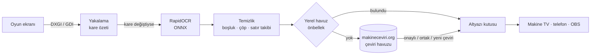

<p align="center">
  
</p>

<h1 align="center">Makine Live</h1>

<p align="center">
  Oyun ekranındaki İngilizce diyalogları okuyup <b>anında Türkçe altyazı</b> olarak gösteren canlı çeviri motoru.<br>
  <a href="https://makineceviri.org">Makine Çeviri</a> ekosisteminin parçası; <a href="https://github.com/MakineCeviri/Makine-Launcher">Makine Launcher</a> eklentisi.
</p>

<p align="center">
  
  
  
  <a href="LICENSE"></a>
</p>

<p align="center">
  <a href="https://makineceviri.org/live/"><b>İndir</b></a> ·
  <a href="docs/GTA6_MAKINE_LIVE_REHBERI.md">Kullanım rehberi</a> ·
  <a href="docs/KONSOL_TV.md">Konsol / TV modu</a> ·
  <a href="docs/MIMARI.md">Teknik mimari</a> ·
  <a href="SECURITY.md">Güvenlik</a>
</p>

---

## Ne yapar?

Makine Live, oyun oynarken ekranın altyazı bölgesini sürekli okur (OCR), yeni bir satır belirdiğinde onu Türkçeye çevirir
ve oyunun üstünde, okunması kolay bir altyazı kutusu olarak gösterir. Oyunun dosyalarına dokunmaz; yama gerektirmez.

Canlı çeviride iki sorun vardır: makine çevirisi her satırda 400–900 ms sürer ve aynı cümleler binlerce oyuncu tarafından
tekrar tekrar çevrilir. Makine Live bunu bir **ortak çeviri havuzu** ile çözer:

1. Okunan satır önce bilgisayardaki önbelleğe ve oyunun **onaylı çevirilerine** bakılarak aranır; bulunursa ağa hiç çıkılmaz.
2. Yoksa satır [makineceviri.org](https://makineceviri.org) havuzuna sorulur. Havuzda da yoksa sunucu satırı **bir kez**
   çevirir; aynı satırı gören sonraki oyuncular aynı çeviriyi alır.
3. Her oyuncu bir oy sayılır. Farklı hesaplardan uyuşan çeviriler gelince satır kendiliğinden onaylanır; uyuşmayanları
   Makine Çeviri çevirmenleri inceler, düzeltir ve onaylar. Oyun oynandıkça havuz büyür ve kalitesi artar.

## Özellikler

- **Hızlı ekran okuma:** DXGI Desktop Duplication (değişmeyen sahnede ~1 ms), gerektiğinde GDI; tam ekran oyunlarda çalışır.
- **Yerel OCR:** RapidOCR (PaddleOCR modelleri + ONNX Runtime). Görüntü bilgisayardan çıkmaz; sunucuya yalnızca metin gider.
- **Oyun yazılarına özel temizlik:** yapışık kelimeleri ayırma ("Iwas goingto" → "I was going to"), yabancı alfabe gürültüsü ve
  çöp satır filtresi, daktilo efektinde satır takibi, titreyen OCR için kararlılık beklemesi.
- **Ortak çeviri havuzu:** onaylı çeviriler bilgisayara iner ve çevrimdışı da çalışır; aynı satır bir daha çevrilmez.
- **Okunabilir altyazı:** piksel bazında saydam kutu, satırın ekranda kaldığı süre ve okuma hızına göre zamanlama,
  kutu yayında ve ekran paylaşımında gizli (isteğe bağlı görünür).
- **Yalnızca oyunlar:** Steam, Epic, GOG, Ubisoft Connect, EA, Xbox / Game Pass ve Windows oyun listesinden kurulu oyunları
  tanır; tarayıcı, Discord ya da başka bir pencere asla okunmaz.
- **Konsol / TV modu:** PS5 ve Xbox oyunları için. Konsolun görüntüsü PC'de (PS Remote Play, Xbox uygulaması, yakalama
  kartı) okunur; altyazı TV'deki **Makine TV** uygulamasında (Android TV / Google TV, LG webOS), PC ekranında,
  telefonda ya da OBS tarayıcı kaynağında gösterilir.
- **Makine Çeviri hesabıyla giriş:** uygulama bir kod gösterir, tarayıcıda onaylarsınız. Kullanıcının API anahtarı gerekmez.

## Nasıl çalışır?



Ayrıntılar (C ABI, yakalama, pipeline, sunucuyla sözleşme, konsensüs kuralları, normalizasyon, uygulama ve TV protokolü):
**[docs/MIMARI.md](docs/MIMARI.md)**.

## Bileşenler

| Bileşen | Klasör | Durum |
|---|---|---|
| **`makine-live.dll`** — C++23 çekirdeği: yakalama, OCR, temizlik, önbellek, çeviri. Makine Launcher'ın yüklediği nihai ürün (`.makine` paketi) | `src/`, `include/` | beta |
| **Makine Live uygulaması** — tek dosyalık `MakineLive.exe`: kontrol paneli, oyun algılama, yerel havuz, altyazı kutusu, konsol modu. Özellikler önce burada denenir, sonra DLL'e taşınır | kök klasördeki `*.py` | 0.3.0 beta |
| **Makine TV (Android TV / Google TV)** — HDMI görüntüsünün üstüne altyazı çizen katman uygulaması | `tv/` | beta |
| **Makine TV (LG webOS)** — konsol görüntüsünü kendi içinde açıp altyazıyı üstüne yazan uygulama + servis | `tv-webos/` | beta |
| **Sunucu** — çeviri havuzu, hesaplar, çevirmen portalı (`makineceviri.org/api/live/`, Cloudflare Workers) | ayrı depo | canlı |

## Kullanım

1. [makineceviri.org/live](https://makineceviri.org/live/) adresinden `MakineLive.exe`'yi indirip açın (kurulum gerekmez).
2. **Makine Çeviri hesabıyla giriş yap**'a basın, tarayıcıda açılan sayfada kodu onaylayın.
3. Oyunu açın; Makine Live oyunu kendisi bulur. Altyazı bölgesini **F10** ile seçin, **F9** ile başlatın.
   **F8** altyazı kutusunu kilitler / taşınabilir yapar.

Konsolda (PS5 / Xbox) oynuyorsanız: [docs/KONSOL_TV.md](docs/KONSOL_TV.md). Kurulumdan TV modellerine, telefon ve OBS'ye
kadar ayrıntılı rehber: [docs/GTA6_MAKINE_LIVE_REHBERI.md](docs/GTA6_MAKINE_LIVE_REHBERI.md).

**Makine Launcher eklentisi olarak:** `makine-live.makine` paketini Launcher → Ayarlar → Eklentiler'den yükleyin.

## Geliştirme

### Gereksinimler

- Windows 10/11 (x64)
- GCC 15 (MinGW-w64) ya da C++23 destekli başka bir derleyici, CMake ≥ 3.25, Ninja
- Python 3.13+ (masaüstü uygulaması, testler ve paketleme için): `py -m pip install -r requirements.txt`
- İsteğe bağlı: Android SDK + JDK 17 (Makine TV), Node.js (LG servis testi)

### OCR çalışma dosyaları

Boyutları nedeniyle depoda değiller. [RapidOcrOnnx](https://github.com/RapidAI/RapidOcrOnnx) sürümünden
`RapidOcrOnnx.dll` ve `onnxruntime.dll`'i, PaddleOCR ONNX modellerini şu düzenle yerleştirin:

```
third_party/rapidocr/
├── RapidOcrOnnx.dll
├── onnxruntime.dll
└── models/
    ├── ch_PP-OCRv3_det_infer.onnx
    ├── ch_ppocr_mobile_v2.0_cls_infer.onnx
    ├── ch_PP-OCRv3_rec_infer.onnx
    └── ppocr_keys_v1.txt
```

### Derleme ve paketleme

```powershell
cmake -B build -G Ninja -DCMAKE_BUILD_TYPE=Release
cmake --build build              # → build/release/makine-live.dll (+ OCR dosyaları, modeller, ikon)

py pack.py                       # → makine-live.makine (Launcher eklenti paketi)
py build_exe.py                  # → dist/MakineLive.exe (tek dosyalık uygulama)
py game_overlay.py               # uygulamayı derlemeden çalıştırma (geliştirme)
```

### Testler

```powershell
py tests/test_plugin.py          # DLL ABI, ayarlar ve DPAPI, gerçek OCR
py tests/test_normalization.py   # ortak normalizasyon vektörleri
ctest --test-dir build           # C++ boşluk düzeltici
```

Bütün testlerin listesi ve gereksinimleri: [tests/README.md](tests/README.md).

### Geliştirme sunucusu

Uygulama varsayılan olarak `https://makineceviri.org` ile konuşur. Yerel bir sunucuya bağlamak için
`MAKINE_LIVE_SERVER` ortam değişkenini ayarlayın.

## Proje yapısı

```
├── src/, include/        C++ çekirdeği ve Launcher ile ortak C ABI başlıkları
├── *.py                  Makine Live masaüstü uygulaması (test koşucusu)
├── tv/, tv-webos/        Makine TV: Android TV / Google TV ve LG webOS
├── spec/                 istemci ve sunucunun paylaştığı test vektörleri, tasarım dili
├── resources/            kelime sıklık listesi, eklenti ikonu
├── tools/                ikon üretimi, LG paketleyici, TV emülatör testi
├── tests/                bütün testler
└── docs/                 teknik mimari, kullanıcı rehberleri, sürüm notları
```

## Gizlilik ve güvenlik

- Ekran görüntüsü ve OCR bilgisayarda kalır; sunucuya yalnızca okunan metin satırı ve oyunun adı gider.
- Oturum jetonu ve (geliştirici motorları için) API anahtarı Windows DPAPI ile şifrelenerek saklanır.
- Depoda hiçbir anahtar, şifre ya da jeton yoktur. Açık bildirmek için: [SECURITY.md](SECURITY.md).

## Katkıda bulunma

Hata bildirimi ve öneriler için [Issues](https://github.com/MakineCeviri/Makine-LauncherPlugin-Live/issues) kullanın.
Kod katkısında:

1. Değişikliği küçük ve konuya göre ayrı tutun (`fix(capture): …`, `feat(overlay): …`).
2. Python'da denenen her yetenek sonunda C++ çekirdeğine taşınır; Python'a kalıcı mimari kurmayın.
3. İlgili testleri çalıştırın; mimari değiştiyse [docs/MIMARI.md](docs/MIMARI.md)'yi aynı değişiklikte güncelleyin.
4. Normalizasyon ya da çöp kurallarını değiştirirseniz `spec/` vektörlerini de güncelleyin.

## Lisans

[AGPL-3.0](LICENSE) + Commons Clause: kaynak kodu açıktır, değiştirilip paylaşılabilir; yazılımın kendisi ücretli olarak
satılamaz. Üçüncü taraf bileşenler: `resources/en_words.txt` ([wordninja](https://github.com/keredson/wordninja), MIT),
çalışma zamanında [RapidOcrOnnx](https://github.com/RapidAI/RapidOcrOnnx) ve [ONNX Runtime](https://onnxruntime.ai) (depoda değil).

<sub>Makine Live, [Makine Çeviri](https://makineceviri.org) topluluğu tarafından geliştirilir.</sub>
