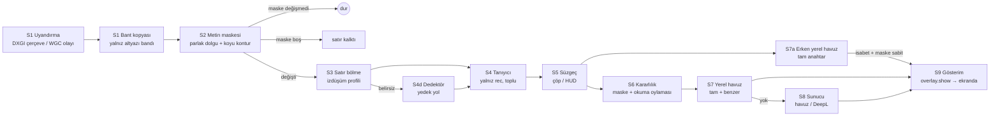

# Makine Live — OCR ve Gecikme Mimarisi

> [!IMPORTANT]
> **Öneri — Fable/Sezer onayı bekliyor.** Bu belge bir karar önerisidir, uygulanmış bir mimari değildir.
> Mühendislik kısmı Opus tarafından yazıldı (2026-11-24; Fable'ın kullanım sınırı 2026-11-27'de açılıyor).
> Ürün ve "his" kararları (konuşmacı adının nasıl gösterileceği, varsayılan model, GPU kullanımı) Fable/Sezer onayından geçmeden kesinleşmez.

**Kural:** Bu belgedeki her hız, doğruluk ve kaynak rakamı **(V) = ölçülene kadar varsayım**dır. Yalnızca
**(Ö: kaynak)** ile işaretli rakamlar ölçülmüştür. Bir karar, ölçüm onu çürütürse geri alınır; ölçümleri
`ocr-bench` dalındaki kıyas düzeni (§7) üretir, geçme kuralları §6'dadır.

**Hangi kod:** Bu belge Launcher'a taşınan **ABI 2 eklentisini** anlatır (`Makine-LauncherPlugin-Live` ana kopyasında
`src/engine.cpp` yakalama + ağ iş parçacıkları, `src/capture.cpp`, `src/ocr_rapid.cpp`, `src/subtitle_timing.cpp`,
`src/local_pool.cpp`). Bu çalışma ağacı (`feat/ocr-bench-2026-11-24`) 0.3.2 tabanındadır; `engine.cpp` burada yoktur.
Satır numarası verilmez, adlar verilir.

---

## 1. Hedef ve ilkeler

- **Ölçüt:** "Altyazı oyunda belirdi" → "Türkçesi ekranda" süresi en kısa, okunan metin en doğru, oyun hiç yavaşlamaz.
- **Hız, özellik eklemekten değil kusursuz çözümden gelir.** Her aşamanın işi "yapılmaması gereken işi yapmamak"tır:
  değişmeyen kareyi okumamak, bilinen bandı aramamak, havuzda olan satırı beklememek.
- **Antivirüs:** kanca yok, enjeksiyon yok, oyun sürecine dokunma yok, karede dosya yazma yok, çalışma anında
  çalıştırılabilir kod indirme yok. Modeller veridir.
- **Oyun önceliklidir:** Live'ın CPU'su oyunun kare süresini bozarsa Live yanlıştır (kapı G-FT, §6).

## 2. Bugünkü hat (taban çizgisi)

```
her 100 ms (kPollS)
  capture.cpp   DXGI (EnumOutputs(0), birincil monitör) | GDI (diğer monitörler) | PrintWindow (konsol penceresi)
  engine        bölgenin TÜM baytlarının 64-bit hash'i → aynıysa önceki metin (~1 ms)
  ocr_rapid     kareyi %TEMP%\...\capture.bmp'ye yaz → RapidOcrOnnx OcrDetect (det v3 → [cls kapalı] → rec ch v3)
                OcrInit(..., 4 iş parçacığı), maxSideLen 1024, padding 50, doAngle 0
  engine        dropForeignScriptTokens → SpacingFixer → çöp süzgeci → LineTracker
  LineTracker   2 ardışık benzer okuma (STABLE_POLLS 2, ≈200 ms) ya da en çok 0,6 sn; daktilo: 0,25 sn büyümezse gönder
  ağ (2 iş p.)  yerel havuz (tam anahtar + ≥%90 benzer) → sunucu /api/live/translate (havuz | shared | DeepL)
  Scheduler     okuma süresi, sıra → host().emitEvent("overlay.show") → Launcher TranslationOverlay.qml
```

**Bugünkü taban (formül):** altyazı t0'da belirir →
`bekleme U(0,100) ms + OCR₁ + 100 ms + OCR₂ (ikinci, kararlılık okuması) + ağ + overlay çizimi`.
OCR ≈ X ms ise yerel havuz isabetinde en iyi durum ≈ `150 + 2·X + 16` ms (V). Sunucu havuzunda ağ medyanı 32 ms
(Ö: MIMARI §5, Python `HttpPool`), DeepL'de 400–900 ms (Ö: MIMARI §1). Daktilo altyazıda +250 ms (`GROW_QUIET`).

**Bilinen açıklar (kodda görülen):**

| # | Açık | Sonuç |
|---|------|-------|
| A1 | Ham piksel hash'i: arkada canlı 3B sahne / Remote Play video akışı varsa her kare farklıdır | "değişmeyen kare ~1 ms" oyun sırasında geçerli değil; OCR her 100 ms'de çalışıyor olabilir (V) — ilk ölçülecek şey |
| A2 | OCR girdisi diske BMP olarak yazılıp okunuyor | Her OCR'da dosya G/Ç; antivirüs gerçek zamanlı taraması bu dosyaya takılabilir |
| A3 | `OcrInit` 4 iş parçacığıyla; ORT iş parçacıkları varsayılan olarak döner (spin) | OCR anında 4 çekirdek oyunla yarışır |
| A4 | Tanıyıcı Çince PP-OCRv3; İngilizce boşlukları yutuyor | `SpacingFixer` ve `dropForeignScriptTokens` yamaları bunun için var |
| A5 | DXGI yalnız `EnumOutputs(0)`; diğer monitörler GDI | İkinci monitörde, hibrit GPU dizüstünde yavaş/yanlış yol |
| A6 | HDR işlenmiyor (`DuplicateOutput`, 8 bit) | HDR masaüstünde soluk/yanlış görüntü olabilir (V) |
| A7 | `PrintWindow` değişiklik bildirmez | Konsol yolunda her turda tam kopya (~9 ms, Ö: MIMARI §5) |
| A8 | Launcher'ın `TranslationOverlay` penceresinde `WDA_EXCLUDEFROMCAPTURE` yok (Launcher'da `SetWindowDisplayAffinity` geçmiyor) | Kutu bandın üstündeyse DXGI kendi çevirimizi okur; bugün yalnız motorun "kendi metnimiz" süzgeci koruyor |
| A9 | Her yeni satır için iki tam OCR (kararlılık iki OCR sonucunun eşitliğiyle) | Gecikmenin en büyük kalemi büyük olasılıkla bu (V) |

## 3. Hedef hat



Aşama kimlikleri (S1…S9) kıyas düzeninin ölçüm anahtarlarıdır (§6, §7).

İş parçacıkları (iş hattı): **yakala** (S1–S3, ucuz, 30 Hz'e kadar) → tek yuvalı kuyruk ("en yeni kazanır") →
**OCR** (S4–S6, tek iş parçacığı + ORT 1–2 iç iş parçacığı) → **ağ** (S7–S8, mevcut 2 iş parçacığı) → **gösterim**
(Scheduler, mevcut). OCR N. kareyi tanırken yakalama N+1'in maskesine bakar; ağ isteği kararlılık anında çıkar,
Scheduler'ı beklemez.

## 4. Kararlar

Her karar: **Karar** · **Neden** · **Sıra** (F1 = ilk faz) · **Ölçüm/kapı**. "Giriyor / girmiyor" açıkça yazılıdır.

### K1 — Tanıyıcıyı kendimiz çağırıyoruz: ONNX Runtime C API, bellekten girdi (GİRİYOR, F1)
- **Karar:** RapidOcrOnnx'in `OcrDetect(dosya)` çağrısı yerine kendi ince sarmalayıcımız: ORT C API ile det ve rec
  oturumları, girdi doğrudan bellekteki BGRA banttan. BMP dosyası kalkar. `onnxruntime.dll` Microsoft'un imzalı
  resmî sürümü olarak eklenti klasöründe (C API, MinGW'den içe aktarma sorun değil (V)).
- **Neden:** (1) Dedektörsüz yol (K4) RapidOcrOnnx'in C API'siyle yapılamaz; o her çağrıda dedektörü çalıştırır.
  (2) Karede disk G/Ç ve antivirüs tarama yüzeyi kalkar (A2). (3) İş parçacığı/spin/bellek ayarları bizde olur (K8).
  (4) İmzalı resmî ORT, imzasız üçüncü taraf DLL'den antivirüs açısından daha temizdir (V).
- **Ölçüm:** B0 taban ile aynı model + aynı kırpıntıda **çıktı birebir aynı** olmalı (sarmalayıcı doğruluğu), S4 süresi
  ≤ taban. Paket boyutu farkı raporlanır.

### K2 — Değişiklik güdümlü yakalama (GİRİYOR, F2)
- **Karar:** Kör 100 ms uykusu yerine `AcquireNextFrame(timeout ≈ 33 ms)` uyandırma sinyalidir; `GetFrameDirtyRects`
  bantla kesişmiyorsa kare atlanır. GPU'dan yalnız bant kopyalanır (`CopySubresourceRegion` → küçük staging doku).
  Kesişiyorsa karar **metin maskesine** (K3) bırakılır.
- **Neden:** Oyun çizerken kirli dikdörtgen büyük olasılıkla bütün çıktıdır (V); yani kirli dikdörtgen bir **süzgeç
  değil, uyandırma sinyalidir**. Masaüstü/menü sahnelerinde ise bedava atlama sağlar. Gerçek ayrım K3'tedir.
- **Girmiyor:** Hareket dikdörtgenleri (`GetFrameMoveRects`) altyazı için anlamlı değil; kullanılmaz.
- **Ölçüm:** B4 — oynanış videosunda saniyedeki OCR çağrısı (kapı G-RATE).

### K3 — Metin maskesi: değişiklik ve varlık sinyali (GİRİYOR, F2 — hattın merkezi)
- **Karar:** Bant, yarım çözünürlükte (V) "altyazı pikseli" maskesine çevrilir: yüksek parlaklıklı dolgu (beyaz/sarı:
  `max(R,G,B)` ile, sarı da parlak sayılsın) **ve** komşuluğunda koyu kontur/gölge. Maskenin satır ve sütun
  izdüşümlerinin hash'i değişiklik sinyalidir; maske piksel sayısı varlık sinyalidir (boş maske = satır kalktı,
  OCR'sız).
- **Neden:** Altyazının arkasındaki 3B sahne değişir, altyazının kendisi değişmez. Ham hash bu ikisini ayıramaz (A1);
  maske ayırır. Aynı maske K4'ün satır bölmesini ve K11'in kararlılığını da besler: bir hesap, üç iş.
- **Risk:** Konturu olmayan, düşük kontrastlı ya da koyu kutu içinde beyaz yazı. Koyu kutulu altyazı maskeyi kolaylaştırır;
  konturu olmayan ince yazı için eşik oyun başına ayarlanabilir olmalı (öğrenilmiş bant profiliyle, K4).
  Maske güvenilmezse (doluluk aralık dışı) o kare için ham hash + OCR yoluna düşülür.
- **Ölçüm:** S2 süresi; B4 yanlış-negatif oranı (maske "değişmedi" dedi ama metin değişti) — kapı G-MISS = 0.

### K4 — Bant biliniyorsa dedektörsüz yol (GİRİYOR, F2)
- **Karar:** Bant (kullanıcının seçtiği bölge ya da öğrenilmiş bant) içinde maskenin yatay izdüşümü satırları ayırır;
  her satır kenar boşluğuyla kırpılır ve doğrudan tanıyıcıya gider. Dedektör yalnızca **yedek**tir:
  ilk kalibrasyon, izdüşüm belirsiz (beklenenden çok tepe, satır yüksekliği bandın öğrenilmiş aralığı dışında),
  ya da tanıyıcı güveni eşiğin altında.
- **Öğrenilmiş bant:** Dedektörün ilk K başarılı okumasından (V: K=5) satır yüksekliği aralığı, sol/sağ sınırlar ve
  maske eşiği oyun başına `dataDir`'e yazılır; sonraki oturum doğrudan dedektörsüz başlar.
- **Neden:** Dedektör hattın en pahalı aşaması (V); altyazı bandında satırlar yataydır ve maskeyle zaten ayrılır.
- **Ölçüm:** B2 — aynı karelerde dedektörsüz vs dedektörlü CER farkı ≤ 0,3 puan (V), S3+S4 vs S4d+S4 süresi.

### K5 — Açı sınıflandırıcı (GİRMİYOR, F1)
- `doAngle`/`mostAngle` zaten 0; kazanç süre değil. Karar: cls modeli **yüklenmez ve pakete konmaz** (bellek + paket boyutu).
  K1 ile kendiliğinden gerçekleşir.

### K6 — Tanıyıcı modeli: aday listesi, kazanan ölçümle (F1 ölçüm, F2 geçiş)
- **Kayıtlı karar ile çatışma:** MIMARI §3.3 Çince PP-OCRv3'ü oyun yazı tiplerinde **ölçülmüş en güvenilir** model
  olarak seçmiş, İngilizce v3 stilize satırlarda anlamsız çıktı vermiş. Bu öneri o kararı **çiğnemez**: İngilizce
  model ancak oyun setinde `ch` v3'ü CER'de yenerse varsayılan olur.
- **Adaylar** (PaddleOCR 3.x model listesi; ONNX'e paddle2onnx ile, girdi yüksekliği 48 (V)):
  1. `ch_PP-OCRv3_rec` — taban (bugünkü).
  2. `en_PP-OCRv4_mobile_rec` — 7,5 MB.
  3. `en_PP-OCRv5_mobile_rec` — 7,5 MB; PaddleOCR'ın kendi setinde ort. doğruluk %85,25 (v4: %70,39) ve
     "boşluk yutmayı iyileştirir" notu var (Ö: PaddleOCR belgesi; **bizim setimizde değil**).
  4. `latin_PP-OCRv5_mobile_rec` — 14 MB; ürün yalnız İngilizce kaynak, daha büyük karakter kümesi gereksiz karışıklık
     demek (V). Yalnız 2. ve 3. kaybederse denenir.
- **Kazanç nerede:** İngilizce model kazanırsa `SpacingFixer` ve `dropForeignScriptTokens` ana yoldan çıkar (yalnız
  güvenlik ağı), havuz anahtarı eşleşme oranı yükselir (V).
- **INT8:** Kazanan modelin dinamik INT8 nicemlenmiş hâli ayrı aday. CTC tanıyıcıda doğruluk kaybı olabilir (V);
  kapı: CER farkı ≤ 0,3 puan ve S4 ≥ %25 hızlı (V), yoksa FP32 kalır.
- **Lisans:** PaddleOCR modelleri Apache-2.0 (V — paket öncesi doğrulanacak, `third_party` README'sine yazılacak).
- **RapidOcrOnnx/ORT uyumu:** v5 rec ONNX'inin bizim ön/son işlemimizle (yükseklik 48, CTC, sözlük dosyası) çalıştığı
  B1'de doğrulanır.

### K7 — Tanıyıcı yüksekliğine ön işlem (GİRİYOR, F2)
- **Karar:** Satır kırpıntısı en-boy korunarak yüksekliğe (48 px (V)) ölçeklenir: küçültmede alan ortalaması, büyütmede
  çift doğrusal. Satırlar tek çağrıda **toplu** tanınır (genişlik en uzun satıra dolgulanır).
- **Adaylar (B1'de ölçülür):** (a) RGB olduğu gibi (modeller RGB ile eğitildi) — varsayılan; (b) maskeyle arka plan
  bastırılmış (konturun dışı düz renk); (c) `max(R,G,B)` gri. (b)/(c) yalnız CER'i ölçülerek düşürürse girer.
- **Girmiyor:** Keskinleştirme, ikilileştirme, süper çözünürlük — tanıyıcıyı eğitim dağılımının dışına iter (V),
  kanıt olmadan eklenmez.

### K8 — Sıcak oturum ve oyunla kavga etmeyen iş parçacıkları (GİRİYOR, F1)
- **Karar:**
  - ORT `intra_op_num_threads` = 1 (aday 2), `inter_op` = 1, sıralı yürütme, **`session.intra_op.allow_spinning = 0`**
    (dönen iş parçacığı boşta da çekirdek yer). Bugünkü 4 iş parçacığı (A3) kalkar.
  - OCR ve yakalama iş parçacıkları `THREAD_PRIORITY_BELOW_NORMAL`. Ağ iş parçacıkları normal (çoğunlukla bekler).
  - Oturumlar Live başlarken açılır, bir ısınma çıkarımı yapılır (arena ayrılır, ilk çağrı gecikmesi oyuna taşmaz);
    Live durduktan N dk (V: 5) sonra bırakılır.
  - **Benzeşim (affinity) sabitlenmez:** sert benzeşim oyunun zamanlayıcısıyla kavga eder ve hibrit CPU'da yanlış
    çekirdeğe kilitleyebilir.
  - **EcoQoS** (`SetThreadInformation(ThreadPowerThrottling)`) iş parçacığı düzeyinde **aday**: hibrit CPU'da bizi
    E-çekirdeklere iter (oyuna iyi) ama S4'ü uzatır (bize kötü). B3'te iki yönüyle ölçülür. Süreç düzeyi ayar yapılmaz:
    host (`makine-plugin-host.exe`) Launcher'ın ikilisidir; eklenti başına ayrı süreç olsa da süreç politikası
    Launcher'ın kararıdır.
- **Ölçüm:** B3 — oyun yükü altında S4 p95, G-CPU, G-FT.

### K9 — Daktilo (harf harf beliren) altyazı (GİRİYOR, F3)
- **Karar:** Maske sağa doğru büyüyorsa (sütun izdüşümü yalnız uçta artıyor) satır "büyüyor" durumundadır; her
  büyümede yeniden OCR yapılmaz, yalnız büyüme durunca (mevcut `GROW_QUIET` 0,25 sn) ya da K12'nin önek ön-yüklemesi
  için seyrek (V: 150 ms'de bir) okunur. `MAX_GROW_WAIT` 3 sn kuralı korunur.
- **Ölçüm:** D-D seti; büyüme süresince OCR sayısı ve "büyüme bitti → Türkçe" süresi.

### K10 — Konuşmacı adı ayırma (KISMEN, F3 — onay gerekiyor)
- **Çatışma:** Havuz anahtarı sunucuda spec v2 ile hesaplanır ve iki depoda ortak vektörlerle test edilir (MIMARI §4.3).
  Adı satırdan ayırmak anahtarı değiştirir → **iki depolu spec değişikliği** (Makine-WEB + vektörler + sunucuda
  anahtarların yeniden hesaplanması).
- **Öneri:** F3'te yalnız **gösterim tarafı**: `AD: metin` ya da farklı renkli ad (maskede ayrı renk kümesi) tanınır,
  kutuda ad çevrilmeden ayrı gösterilir; havuza giden metin bugünkü gibi değişmez. Anahtardan ayırma ayrı karar
  (Fable/Sezer + Makine-WEB).

### K11 — Kararlılık: her karede OCR değil, maske + okuma oylaması (GİRİYOR, F2)
- **Karar:** Bugün kararlılık = iki ayrı OCR sonucunun benzerliği (≈200 ms + 2 OCR, A9). Yeni: maske 2 uyanışta
  (≈66 ms (V)) sabitse **tek** OCR yeterlidir; maske değişmedikçe yeniden okunmaz. Aynı satır için birden fazla okuma
  varsa (maske titredi) karakter düzeyinde çoğunluk oylaması + tanıyıcı güveni ile en iyi okuma seçilir
  (`LineTracker`'ın "en çok boşluklu okuma" kuralı oylamanın bir girdisi olarak kalır).
- **Korunan:** `SAME_LINE` 0,80, `MISS_*`, `REDISPATCH_SIM`, Scheduler'ın okuma süresi kuralları — davranış vektörleri
  (`ctest`) aynen geçmeli.
- **Ölçüm:** E2E p50 düşüşü; kararlılık yanlışı (yarım satır gönderme) oranı ≤ taban.

### K12 — Erken yerel havuz araması (GİRİYOR, F2; önek kısmı F3 ve korumalı)
- **Karar (tam anahtar):** İlk OCR okuması (kararlılığı beklemeden) yerel havuzda **tam anahtar** olarak aranır.
  İsabet + maske sabitse çeviri hemen gösterilir. Onaylı havuz satırının metni doğrulanmış metindir; tam anahtar
  isabeti OCR'ın doğru okuduğunun kanıtıdır.
- **Kayıtlı karar ile çatışma:** MIMARI §3.3 önek kısayolunu **bilerek** kaldırmış (ortak başlangıçlı farklı cümleler
  karışıyordu). Bu öneri onu geri getirmez: önek yalnız **spekülatif ön-yükleme**dir — daktilo büyürken önek
  ≥ 20 karakter (V) ve havuzda **tek** adaya iniyorsa çeviri belleğe alınır ama **gösterilmez**; tam satır tam/benzer
  kuralla eşleşince anında çıkar. 12 karakterden kısa anahtarların ve rakamı farklı satırların eşleşmeme kuralı aynen.
- **Ölçüm:** Yanlış satır gösterme oranı (kapı G-WRONG = 0), yerel isabette E2E.

### K13 — İş hattı ve bağlantı (GİRİYOR, F1–F2)
- Tek yuvalı kuyruklar (en yeni kazanır), §3'teki iş parçacığı düzeni. Ağ isteği kararlılık anında çıkar.
- WinHTTP oturumu ve bağlantısı yeniden kullanılır (keep-alive); Live başlarken ve bağlantı uzun süre boşta kalınca
  (V: 50 sn) ısıtma isteği. HTTP/2 (`WINHTTP_OPTION_ENABLE_HTTP_PROTOCOL`) ve Win11'de HTTP/3 **aday**: S8 p95'e etkisi
  ölçülürse girer.
- Oyun başlarken havuz eşitlemesi (`pool?action=sync`) bitmiş olmalı; yerel isabet oranı E2E'nin en büyük kaldıracıdır (V).

### K14 — Windows.Media.Ocr (ADAY, ölçülecek; F2 ölçüm)
- Model taşımaz, sistem bileşeni (antivirüs açısından ideal), çok hızlı olabilir (V).
- **Engeller:** İngilizce tanıyıcı için `en-US` OCR dil bileşeni kurulu olmalı; Türkçe Windows'ta kurulu olmayabilir (V —
  `OcrEngine.AvailableRecognizerLanguages` ile denetlenir). WinRT'yi MinGW ile derlenen statik hosttan çağırmak
  (`RoActivateInstance` + ABI arayüzleri) yapılabilirlik denetimi ister. Satır bölme kontrolü bizde değildir.
- **Kural:** Ancak oyun setinde CER ve S4'te seçilen ORT yolunu yenerse **ve** hedef makinelerde dil bileşeni
  çoğunlukla varsa ikinci motor olur; yoksa girmez.

### K15 — DirectML / GPU (ADAY, varsayılan KAPALI; F3 ölçüm)
- GPU oyunundur. DirectML çıkarımı oyunun kare süresinden çalar (V). Ayrıca DirectML'li ORT daha büyük paket demek.
- **Kural:** Yalnız G-FT'yi geçer **ve** S4'te belirgin kazanç (V: ≥ 2×) verirse "isteğe bağlı" olarak girer. Varsayılan CPU.

### K16 — HDR (GİRİYOR, F3; önce ölçüm)
- B-HDR: HDR açık masaüstünde bugünkü `DuplicateOutput` görüntüsü CER'i bozuyor mu (V)? Bozuyorsa:
  `IDXGIOutput5::DuplicateOutput1` ile `R16G16B16A16_FLOAT` alınır, **yalnız bant** CPU'da SDR'ye eşlenir
  (scRGB → kırpma + basit ton eşleme), maske eşikleri bu SDR görüntüde çalışır.

### K17 — Çoklu monitör ve hibrit GPU (GİRİYOR, F3)
- Bütün bağdaştırıcıların bütün çıktıları taranır; bölgeyi içeren çıktı `DXGI_OUTPUT_DESC.Monitor` ↔ `MonitorFromRect`
  ile bulunur; D3D aygıtı **o çıktının bağdaştırıcısında** açılır (aksi hâlde `DuplicateOutput`
  `DXGI_ERROR_UNSUPPORTED` döner — hibrit GPU dizüstü). GDI yalnız son çare (A5).

### K18 — Pencere yakalama: Remote Play / chiaki / Xbox / yakalama kartı (ADAY → ölçümle karar, F3)
- Bugün `PrintWindow(PW_CLIENTONLY | PW_RENDERFULLCONTENT)`: üstü kapalı ve GPU ile çizilen pencerede çalışıyor,
  değişiklik bildirmiyor (A7), tur başına ~9 ms (Ö: MIMARI §5, Python ölçümü).
- **Aday:** Windows.Graphics.Capture (WGC): kare geldi olayı (değişiklik güdümlü), GPU'da kalır, üstü kapalı pencere;
  Win11'de sarı çerçeve kapatılabilir (`IsBorderRequired`). WinRT/MinGW yapılabilirliği K14 ile ortak denetim.
- **Kural:** WGC yapılabilir ve B-WIN'de S1 + doğruluk olarak PrintWindow'u yenerse birincil olur; PrintWindow yedek kalır.
- Video akışı sıkıştırılmıştır: harf kenarlarında blok/halka bozulması. Maske eşikleri ve CER seti (D-C) bunu kapsar.

### K19 — Hata durumları (GİRİYOR, F1–F3)

| Durum | Algı | Davranış |
|---|---|---|
| Siyah/düz kare (korumalı içerik, küçültülmüş, DRM) | Bant varyansı ≈ 0 | "okunamıyor" durumu, geri çekilmeli yeniden deneme (bugünkü 5 sn × 6, sonra dakikada bir korunur), OCR yok |
| `DuplicateOutput` sonrası ilk kare sıfır | `LastPresentTime == 0` | O kare atlanır (Launcher sözleşmesi) |
| `DXGI_ERROR_ACCESS_LOST` | hata kodu | Mevcut 500 ms'lik yeniden kurulum korunur |
| Kendi kutumuz bandın üstünde | — | **Launcher tarafı:** `TranslationOverlay` penceresine `SetWindowDisplayAffinity(WDA_EXCLUDEFROMCAPTURE)` (A8; Launcher PR'ı). "Yayında göster" açıkken `WDA_NONE` takası bugünkü gibi kalır; o modda okuma pencerenin kendi içeriğinden (PrintWindow/WGC) yapılır, kutu zaten okunmaz. Motorun "kendi metnimiz" süzgeci yedek olarak kalır |
| Başka katmanlar (Steam, Discord, NVIDIA) bandın üstünde | maske/çöp süzgeci | Okunur ama çöp süzgeci + HUD kuralı eler; ölçüm setinde örnek bulunur |
| Sahne geçişi, HUD yanıp sönmesi | maske doluluğu sıçrar | Kararlılık (K11) geçmeden gönderilmez |
| Hedef önde değil / üstü kapalı (PC modu) | mevcut `capture_block_reason` | Aynen |

### K20 — Bilerek girmeyenler
- Tam kare OCR, her karede OCR, sunucuda OCR (gizlilik: görüntü bilgisayarda kalır, MIMARI §4.4).
- Oyun sürecine kanca / enjeksiyon / altyazıyı bellekten okuma (antivirüs + anti-hile riski).
- Tesseract ve benzeri ikinci tam OCR motorları (K14 dışında).
- Varsayılan GPU çıkarımı (K15).

## 5. Sıra (fazlar)

| Faz | İçerik | Ön koşul |
|---|---|---|
| **F0** | Kıyas düzeni + veri setleri + taban ölçümü (B0) | — (ocr-bench sürüyor) |
| **F1** | K1 (ORT sarmalayıcı, bellekten girdi, cls yok), K8 (iş parçacığı/spin/öncelik/ısınma), K6 ölçümü (B1), K13 bağlantı | B0 |
| **F2** | K3 maske + K2 uyandırma, K4 dedektörsüz yol + öğrenilmiş bant, K7 ön işlem, K11 kararlılık, K12 tam anahtar erken arama, K6 geçişi (kazanan model), K14 ölçümü | F1 |
| **F3** | K9 daktilo, K10 gösterim tarafı ad, K12 önek ön-yükleme, K16 HDR, K17 çoklu monitör, K18 WGC, K15 ölçümü, Launcher `WDA_EXCLUDEFROMCAPTURE` (paralel yürüyebilir) | F2 |

## 6. Kapılar (geçme kuralları)

Önce **B0 tabanı** ölçülür; göreli kurallar ona göredir. Mutlak hedefler **önerilen (V)** değerlerdir — B0 çıktıktan sonra
Fable/Sezer ile kesinleşir. Yüzdelikler en az 200 olaydan (V) hesaplanır.

### 6.1. Uçtan uca (E2E): "altyazı belirdi → Türkçe görünür"

`t0` = altyazı piksellerinin ilk göründüğü kare (kıyas düzeninde bilinen zaman damgası). `t1` = `overlay.show` olayının
çıktığı an + S9 (Launcher'ın kutuyu çizdiği ilk kare; ayrıca ölçülür). Üç yol ayrı ölçülür:

| Kapı | Yol | p50 | p95 | Göreli kural |
|---|---|---|---|---|
| G-E2E-L | Yerel havuz isabeti | ≤ 250 ms (V) | ≤ 400 ms (V) | taban p50'nin ≤ %50'si |
| G-E2E-S | Sunucu havuzu isabeti (pool/shared/own) | ≤ 350 ms (V) | ≤ 600 ms (V) | taban p50'nin ≤ %60'ı |
| G-E2E-D | DeepL (havuzda yok) | ≤ 900 ms (V) | ≤ 1500 ms (V) | taban p50'den kötü olamaz |
| G-E2E-T | Daktilo, büyüme bitti → Türkçe | ≤ 350 ms (V) | ≤ 600 ms (V) | taban ≥ %30 iyileşme |

### 6.2. Aşama süreleri (p50 / p95, oyun yükü altında, 1080p, ORT 1 iş parçacığı)

| Aşama | Ölçülen | Hedef p50 / p95 (V) |
|---|---|---|
| S1 | uyanış → bant CPU'da | ≤ 2 / 5 ms |
| S2 | maske + hash | ≤ 1 / 2 ms |
| S3 | izdüşüm satır bölme | ≤ 0,5 / 1 ms |
| S4 | tanıyıcı, satır başına (toplu çağrıda satır payı) | ≤ 8 / 15 ms |
| S4d | dedektör (yedek yol) | ≤ 40 / 70 ms |
| S5 | süzgeç | ≤ 0,5 / 1 ms |
| S6 | kararlılık bekleme (maske sabit → gönder) | ≤ 70 / 120 ms |
| S7 | yerel havuz, tam / benzer (20 bin satır) | ≤ 0,1 / 0,5 ms · ≤ 5 / 10 ms |
| S8 | sunucu havuzu isabeti (TR ağı) | ≤ 60 / 150 ms |
| S9 | `overlay.show` → kutu ekranda | ≤ 20 / 35 ms |

### 6.3. Doğruluk

| Kapı | Ölçüt | Kural |
|---|---|---|
| G-CER | Karakter hata oranı, oyun seti (D-A + D-B) | Varsayılan olacak model taban `ch` v3'ten **düşük**; mutlak ≤ %2 temiz, ≤ %5 zor set (V) |
| G-CER-C | CER, sıkıştırılmış Remote Play seti (D-C) | ≤ taban; mutlak ≤ %6 (V) |
| G-KEY | Havuz anahtarı (`compact key`) tam eşleşme oranı, satır başına | ≥ %97 (V); taban'dan düşük olamaz |
| G-WRONG | Yanlış satırın çevirisini gösterme (önek/benzer eşleşme) | **0** |
| G-MISS | Maske "değişmedi" dedi, metin değişmişti | **0** |
| G-HALF | Yarım (kararsız) satır gönderme oranı | ≤ taban |
| G-SPACE | Boşluğu doğru satır oranı (SpacingFixer kapalıyken, İngilizce model) | ≥ SpacingFixer'lı taban |

**Gerçek değer (ground truth) asla havuzdan alınmaz** — havuz metni de OCR'dan gelir. Kaynaklar §7.2.

### 6.4. Kaynak ve oyun

| Kapı | Ölçüt | Kural (V) |
|---|---|---|
| G-FT | Oyunun kare süresi p99 ve %1 low, Live açık vs kapalı (PresentMon; GPU-sınırlı ve CPU-sınırlı iki senaryo) | fark ≤ %2 (gürültü bandı içinde) |
| G-CPU | Host sürecinin CPU'su, toplam çekirdeğe oranla | sabit altyazıda ort. ≤ %1; altyazı akışında ort. ≤ %3; OCR patlaması ≤ 1 çekirdek, ≤ 50 ms |
| G-IDLE | Altyazı yok, sahne hareketli | ort. ≤ %0,5, OCR çağrısı 0 |
| G-RATE | Saniyedeki OCR (S4) çağrısı, oynanış videosu, altyazı değişmiyor | ≤ 0,5/sn (taban ölçülür; büyük olasılıkla ~10/sn, A1) |
| G-MEM | Host özel belleği, rec yüklü / det de yüklü | ≤ 150 MB / ≤ 250 MB |
| G-WARM | Live başlat → ilk okuma hazır | ≤ 500 ms; ilk çıkarım ısınmış (ilk çağrı p95'i ≤ 1,5 × kararlı p95) |
| G-IO | Live çalışırken dosya yazma (ProcMon/ETW) | Kare başına 0; dakikada yalnız ayar/havuz/günlük |
| G-AV | Paket Windows Defender ile tarandığında | Temiz; yeni imzasız ikili yok (ORT imzalı) |

## 7. Kıyas düzeni için iş tanımı (`ocr-bench`)

### 7.1. Ölçüm sırası

| Kod | Ne | Çıktı |
|---|---|---|
| **B0** | Bugünkü hat birebir (RapidOcrOnnx, BMP yolu, `ch` v3, 4 iş parçacığı, 100 ms yoklama, 2 okumalı kararlılık) | §6'nın tüm metrikleri: taban |
| **B1** | Tanıyıcı adayları (K6) + ön işlem (K7) + INT8, **aynı satır kırpıntılarında**, yalnız rec | CER, G-KEY, G-SPACE, S4 |
| **B2** | Dedektörsüz (K4) vs dedektörlü, aynı karelerde | CER farkı, S3+S4 vs S4d+S4 |
| **B3** | ORT iş parçacığı 1/2/4 × spin açık/kapalı × öncelik × EcoQoS, oyun yükü altında | S4 p95, G-CPU, G-FT |
| **B4** | Değişiklik sinyali: ham hash vs maske, oynanış videosu | G-RATE, G-MISS, G-IDLE |
| **B5** | Uçtan uca, üç yol | G-E2E-* |
| B-WIN | PrintWindow vs WGC (K18), sahte + gerçek Remote Play penceresi | S1, CER |
| B-HDR | HDR açık masaüstü, `DuplicateOutput` vs `DuplicateOutput1` | CER |
| B-WMO | Windows.Media.Ocr (K14) | CER, S4, dil bileşeni var/yok |

### 7.2. Veri setleri (gerçek değer kaynağı)

- **D-A Sentetik:** Bilinen metin, oyun yazı tipleri (kalın/ince, konturlu, gölgeli, sarı, koyu kutulu), farklı
  yükseklikler (18–48 px (V)), gerçek oyun arka planları (3B sahne kareleri) üstüne çizilir. Gerçek değer kesin.
- **D-B Elle etiketli gerçek oyun kareleri:** En az 5 oyun (V), etiket iki kişi kontrolünde.
- **D-C Sıkıştırılmış:** D-A/D-B'nin PS Remote Play / chiaki benzeri video kodlamasından geçirilmiş hâli (H.264/H.265,
  düşük bit hızı dahil).
- **D-D Daktilo dizileri:** Zaman damgalı kare dizileri.
- **D-E HDR kareleri.**
- **D-F Zamanlı videolar:** E2E için; her altyazının `t0`'ı bilinir. Bir oynatıcı pencere bunları gerçek hızda
  oynatır, hat gerçek yakalamayla okur.

### 7.3. Ortam ve çıktı

- İki makine: geliştirme bilgisayarı + bir düşük uç referans (4 çekirdek (V)). Oyun yükü: bir GPU kıyas döngüsü ve bir
  CPU-ağır oyun sahnesi (G-FT için PresentMon).
- Her koşu tek JSON: `{run, commit, machine, scenario, stage: {S1: {p50, p95, n}, …}, e2e: {L|S|D|T: {p50, p95, n}},
  cer: {set: value}, key_match, wrong, miss, cpu, mem, ft: {p99, low1}}`. Kapı denetimi bu dosyadan
  AYNI/FARK + GEÇTİ/KALDI satırı basar; tam günlük `.logs/`'a.

## 8. İlk üç yapım işi

1. **ORT tanıyıcı sarmalayıcı (K1 + K5 + K8):** ORT C API ile det/rec oturumu, bellekteki banttan girdi (BMP kalkar),
   cls yüklenmez, `intra_op` 1–2, spin kapalı, `BELOW_NORMAL`, ısınma çıkarımı; rec modeli ayardan değişebilir
   (`ch` v3 / `en` v4 / `en` v5). Geçme: B0 ile aynı modelde çıktı birebir aynı, S4 ≤ taban, G-IO = 0. Bu iş B1 ve B3'ü
   mümkün kılar.
2. **Metin maskesi + dedektörsüz yol (K3 + K2 + K4 + K11):** Yakalama iş parçacığında bant kopyası, maske, izdüşüm
   hash'i, satır bölme, öğrenilmiş bant; OCR yalnız maske değişince; kararlılık maskeden. Dedektör yedek. Geçme: G-RATE,
   G-MISS = 0, B2 CER farkı, `subtitle_timing` vektörleri aynen geçer.
3. **Erken tam anahtar havuz araması + iş hattı (K12 tam anahtar + K13):** İlk okumada yerel havuz, tek yuvalı kuyruklar,
   ağ isteği kararlılık anında, bağlantı ısıtma. Geçme: G-E2E-L ve G-E2E-S, G-WRONG = 0.

Paralel ve küçük: Launcher'da `TranslationOverlay` için `WDA_EXCLUDEFROMCAPTURE` (A8) — ayrı Launcher PR'ı.
